# Analytical Modeling of 3D Air Pollutant Dispersion from an Industrial Stack: The Gaussian Plume Model

In this project, I build a Python model of how a gas released from an industrial stack spreads in the air, using the Gaussian plume model, the most widely used model for this problem. The code calculates the concentration in 3D and shows it in three 2D planes: the top view ($x$–$y$), the side view ($x$–$z$) and the cross-sections ($y$–$z$). I formulated the model from the classic references on air dispersion (Turner, 1970; Briggs, 1969, 1973, 1975; U.S. EPA, 1992, 1995), and I checked the results against published worked examples.

Before introducing the example, let's first understand some basic concepts we are going to use throughout the project.

## Basic Concepts and Terms

Once a pollutant leaves the stack, two processes move it:

* **Advection:** The wind carries the pollutant downwind. In the Gaussian plume model, the $x$-axis points in the wind direction. Advection dominates in $x$, so diffusion along $x$ is neglected.
* **Turbulent diffusion (dispersion):** Eddies in the air mix the pollutant with clean air. The plume spreads crosswind ($y$) and vertically ($z$) and becomes more dilute as it travels.

**Point source and emission rate ($Q$):** The stack is treated as a single point that releases the pollutant continuously at a constant rate $Q$ (g/s).

**Plume:** The cloud of polluted air downwind of the stack. At any moment, the real plume meanders; this is the *instantaneous plume*. Averaged over about one hour, it looks like a smooth cone; this is the *time-averaged plume*. The Gaussian plume model predicts the time-averaged concentration.

**Plume centreline:** The line through the centre of the time-averaged plume. The $x$-axis is placed along it, $y$ is crosswind, and $z$ is the height above the ground.

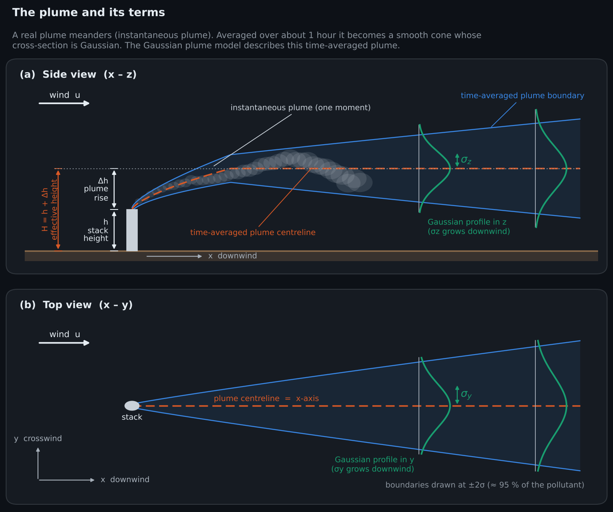

**Physical stack height ($h$), plume rise ($\Delta h$) and effective stack height ($H$):** Hot gas leaving the stack is lighter than the surrounding air and has upward momentum, so it keeps rising for some distance before it bends over with the wind. This extra height is the plume rise. The effective stack height is the height of the plume centreline after the rise:

$$
H = h + \Delta h
$$

**Buoyancy flux ($F$):** A measure of how strongly the hot gas is pushed upward. It comes from the temperature (and density) difference between the stack gas and the air. A hotter gas has more buoyancy, so the plume rises more and the pollution disperses better.

$$
F = g\,v_s\,r_s^2\,\frac{T_s - T_a}{T_s}
$$

* $g$: Gravitational acceleration ($9.81\text{ m/s}^2$).
* $v_s$: Stack gas exit velocity (m/s).
* $r_s$: Stack inside radius (m). With the diameter $d = 2r_s$, the same formula is written $F = \frac{g}{4}\,v_s\,d^2\,\frac{T_s - T_a}{T_s}$.
* $T_s$, $T_a$: Stack gas temperature and ambient air temperature (K).

### The Normal (Gaussian) Distribution

The model assumes that the concentration across the plume follows a normal (Gaussian) distribution. A **probability density function (PDF)** describes the likelihood of a continuous random variable falling within a specific range. For the normal distribution:

$$
f(x) = \frac{1}{\sigma\sqrt{2\pi}}\,e^{-\frac{(x-\mu)^2}{2\sigma^2}}
$$

* $\mu$: Mean value, the centre of the distribution. For the plume, this is the centreline.
* $\sigma$: Standard deviation, which measures the spread of the distribution.
* $e \approx 2.718$ (Euler's number) and $\pi \approx 3.1416$.

About 68 % of the area under the curve lies within $\pm\sigma$ of the mean, and about 95 % within $\pm 2\sigma$. For the plume, this means about 68 % of the pollutant (in each direction, $y$ or $z$) lies within one $\sigma$ of the centreline. The total area stays the same because it represents the emitted mass, so a wider curve must be lower. This is why the concentration falls as the plume spreads.

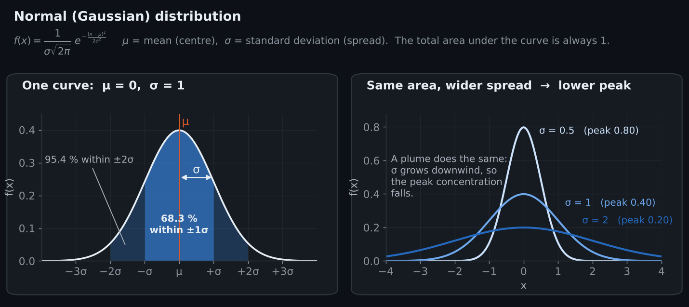

**Dispersion coefficients ($\sigma_y$ and $\sigma_z$):** The standard deviations of the plume in the crosswind direction ($\sigma_y$, lateral dispersion coefficient) and in the vertical direction ($\sigma_z$, vertical dispersion coefficient), in metres. They grow with downwind distance and depend on how turbulent the air is. They are not derived from theory; they come from semi-empirical expressions fitted to field experiments (see Step 2 of the methodology).

### Atmospheric Stability

How fast the plume spreads depends mainly on **atmospheric stability**: the tendency of the air to enhance or suppress vertical motion. It is judged by comparing how fast the air temperature drops with height (the environmental lapse rate) with the **dry adiabatic lapse rate**, $9.8\text{ °C/km}$, which is how fast a rising parcel of dry air cools as it expands:

* **Unstable:** The air cools faster than 9.8 °C/km. A rising parcel stays warmer than its surroundings and keeps rising, so vertical mixing is strong (looping plume). This is typical of sunny days with light wind.
* **Neutral:** The air cools at about 9.8 °C/km, and mixing is moderate (coning plume). This is typical of overcast or windy conditions.
* **Stable:** The air cools slowly or even warms with height (an inversion). A rising parcel becomes colder than its surroundings and sinks back, so vertical mixing is weak (fanning plume). This is typical of clear nights with light wind.

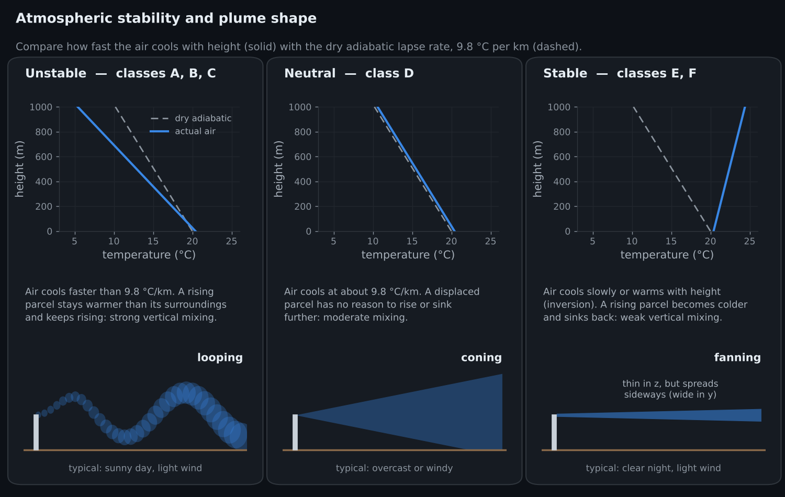

**Pasquill stability classes:** To use stability in calculations, it is grouped into six classes that categorize atmospheric turbulence: **A** (very unstable), **B** (unstable), **C** (slightly unstable), **D** (neutral), **E** (stable) and **F** (very stable). The class is chosen from the wind speed and the amount of sunshine or cloud (Turner, 1970):

| Wind speed at 10 m (m/s) | Day: strong sun | Day: moderate sun | Day: slight sun | Night: thin overcast or ≥ 4/8 low cloud | Night: ≤ 3/8 cloud |
| :--- | :---: | :---: | :---: | :---: | :---: |
| < 2 | A | A–B | B | – | – |
| 2–3 | A–B | B | C | E | F |
| 3–5 | B | B–C | C | D | E |
| 5–6 | C | C–D | D | D | D |
| > 6 | C | D | D | D | D |

Class D is also used for heavy overcast, day or night.

### Wind Speed at the Stack Top

Wind is slower near the ground because of friction, so the wind speed measured at 10 m ($u_{10}$) is corrected to the stack height with a power law:

$$
u = u_{10}\left(\frac{h}{10}\right)^{p}
$$

The exponent $p$ depends on the stability class and the terrain (U.S. EPA, 1992):

| Stability class | A | B | C | D | E | F |
| :--- | :---: | :---: | :---: | :---: | :---: | :---: |
| $p$ (rural) | 0.07 | 0.07 | 0.10 | 0.15 | 0.35 | 0.55 |
| $p$ (urban) | 0.15 | 0.15 | 0.20 | 0.25 | 0.30 | 0.30 |

### Ground Reflection

The ground does not absorb the gas. When the spreading plume reaches the ground, the gas is "reflected" back up, so no mass is lost at the surface. Mathematically, this is done by adding an imaginary mirror source (the **image source**) at $-H$, below the ground. Its plume adds back exactly the part that the real plume would push into the ground.

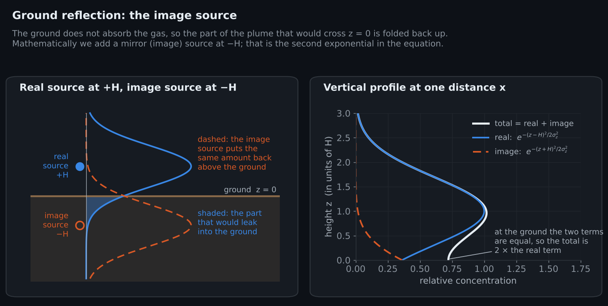

**Mixing height ($L$):** On many days, a temperature inversion aloft acts as a lid. The plume cannot pass through it and becomes trapped between the ground and the lid. The code can include this lid as an option (see Step 3 of the methodology).

## The Gaussian Plume Equation

Putting these ideas together, the concentration at any point $(x, y, z)$ downwind of the stack is:

$$
C(x,y,z) = \underbrace{\frac{Q}{2\pi\,u\,\sigma_y\,\sigma_z}}_{\text{1. Dilution}}\;\underbrace{\exp\left(-\frac{y^2}{2\sigma_y^2}\right)}_{\text{2. Crosswind spread}}\;\underbrace{\left[\exp\left(-\frac{(z-H)^2}{2\sigma_z^2}\right) + \exp\left(-\frac{(z+H)^2}{2\sigma_z^2}\right)\right]}_{\text{3. Vertical spread: real source + image source}}
$$

* **Dilution ($\frac{Q}{2\pi u \sigma_y \sigma_z}$):** The wind $u$ carries the emitted mass through a plume cross-section that grows with $\sigma_y \sigma_z$. A stronger wind or a wider plume gives a lower concentration.
* **Crosswind spread:** A Gaussian in $y$. It equals 1 on the centreline ($y = 0$) and decreases to the sides.
* **Vertical spread:** The first exponential is the real plume centred at height $H$. The second is the image source at $-H$, which represents ground reflection.
* **Units:** $C$ is in g/m³ when $Q$ is in g/s. Multiply by $10^6$ to get µg/m³.

At ground level ($z = 0$) on the centreline ($y = 0$), the two vertical terms are equal, and the equation becomes:

$$
C(x,0,0) = \frac{Q}{\pi\,u\,\sigma_y\,\sigma_z}\exp\left(-\frac{H^2}{2\sigma_z^2}\right)
$$

**Maximum ground-level concentration:** For an elevated stack, the ground-level concentration is zero near the stack, rises to a maximum, and then falls. When $\sigma_z/\sigma_y$ is roughly constant, the maximum occurs where:

$$
\sigma_z = \frac{H}{\sqrt{2}}, \qquad C_{max} = \frac{2\,Q}{\pi\,e\,u\,H^2}\,\frac{\sigma_z}{\sigma_y} \quad\Rightarrow\quad C_{max} \propto \frac{1}{H^2}
$$

This is why tall stacks and hot (buoyant) gases reduce ground-level impacts: doubling the effective height cuts the maximum to roughly a quarter.

### Simplification Assumptions

* **Continuous point source:** The pollutant is released continuously from a single point.
* **Steady state:** The emission rate and the meteorological conditions do not change with time.
* **Constant wind speed and direction:** One wind speed (at the stack top) and one direction for the whole plume.
* **Advection dominates in $x$:** Turbulent diffusion occurs mainly in the $y$ and $z$ directions; diffusion along $x$ is small compared with transport by the wind.
* **Gaussian distribution:** The concentration follows a normal (Gaussian) distribution in $y$ and $z$.
* **Conservative pollutant:** The pollutant does not react, and its deposition rate is negligible.
* **Total reflection at the ground:** Mass is conserved; nothing is lost at the surface.
* **Negligible background pollution.**
* **Flat, unobstructed terrain:** No hills, valleys or buildings.
* **Range of validity:** About 100 m to 10 km downwind, with wind speeds of at least 1 m/s.

## Methodology

The pollution concentration is determined in two main steps: (1) calculate the effective stack height, then (2) predict the concentration downwind with the Gaussian dispersion equation. In the code, these are Step 1 and Step 3 below, with supporting steps around them:

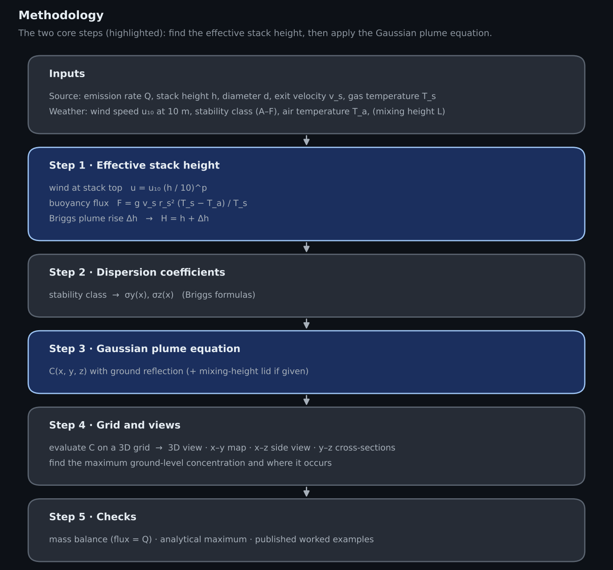

### Step 1: Effective Stack Height

First, the wind speed is corrected to the stack top (power law above) and the buoyancy flux $F$ is calculated. Then the plume rise is found from the Briggs equations.

**Neutral or unstable air (classes A–D):** The plume rises following the "2/3 law" until the distance $3.5x^*$, and then it stops rising:

$$
\Delta h = \frac{1.6\,F^{1/3}\,x^{2/3}}{u} \qquad \text{for } x < 3.5x^*
$$

$$
x^* = 14\,F^{5/8} \quad (F < 55\text{ m}^4/\text{s}^3), \qquad x^* = 34\,F^{2/5} \quad (F \ge 55\text{ m}^4/\text{s}^3)
$$

* $x$: Downwind distance (m).
* $u$: Mean wind speed at the stack top (m/s).
* $x^*$: The distance at which atmospheric turbulence begins to dominate the mixing of the plume with air.

Putting $x = 3.5x^*$ into the 2/3 law gives the final plume rise, which is used beyond that distance:

$$
\Delta h_{final} = \frac{21.425\,F^{3/4}}{u} \quad (F < 55), \qquad \Delta h_{final} = \frac{38.71\,F^{3/5}}{u} \quad (F \ge 55)
$$

**Stable air (classes E and F):** The temperature structure stops the rise earlier:

$$
\Delta h = 2.6\left(\frac{F}{u\,s}\right)^{1/3}, \qquad s = \frac{g}{T_a}\,\frac{\partial\theta}{\partial z}
$$

* $s$: Stability parameter (s⁻²).
* $\frac{\partial\theta}{\partial z}$: Potential temperature gradient, taken as 0.020 K/m for class E and 0.035 K/m for class F (U.S. EPA, 1992).
* Some textbooks give the constant as 2.4 instead of 2.6. I use 2.6, as in the U.S. EPA screening procedures (U.S. EPA, 1992). The difference changes the stable plume rise by about 8 %.
* Close to the stack, the plume still follows the 2/3 law until it reaches this stable final rise.

Finally, the effective stack height is $H = h + \Delta h$.

### Step 2: Dispersion Coefficients

The dispersion coefficients are calculated from the Briggs (1973) formulas for open country (rural) and urban areas, with $x$ in metres (valid for $100\text{ m} < x < 10\text{ km}$):

| Class | Rural $\sigma_y$ (m) | Rural $\sigma_z$ (m) | Urban $\sigma_y$ (m) | Urban $\sigma_z$ (m) |
| :---: | :--- | :--- | :--- | :--- |
| A | $0.22x(1+0.0001x)^{-1/2}$ | $0.20x$ | $0.32x(1+0.0004x)^{-1/2}$ | $0.24x(1+0.001x)^{1/2}$ |
| B | $0.16x(1+0.0001x)^{-1/2}$ | $0.12x$ | $0.32x(1+0.0004x)^{-1/2}$ | $0.24x(1+0.001x)^{1/2}$ |
| C | $0.11x(1+0.0001x)^{-1/2}$ | $0.08x(1+0.0002x)^{-1/2}$ | $0.22x(1+0.0004x)^{-1/2}$ | $0.20x$ |
| D | $0.08x(1+0.0001x)^{-1/2}$ | $0.06x(1+0.0015x)^{-1/2}$ | $0.16x(1+0.0004x)^{-1/2}$ | $0.14x(1+0.0003x)^{-1/2}$ |
| E | $0.06x(1+0.0001x)^{-1/2}$ | $0.03x(1+0.0003x)^{-1}$ | $0.11x(1+0.0004x)^{-1/2}$ | $0.08x(1+0.0015x)^{-1/2}$ |
| F | $0.04x(1+0.0001x)^{-1/2}$ | $0.016x(1+0.0003x)^{-1}$ | $0.11x(1+0.0004x)^{-1/2}$ | $0.08x(1+0.0015x)^{-1/2}$ |

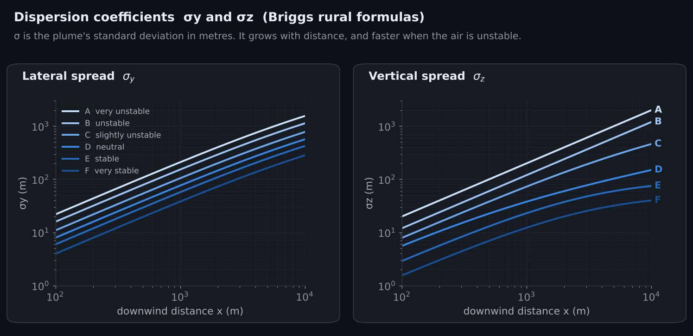

Notice that $\sigma_z$ grows much more slowly in stable air (E and F): the plume stays thin in the vertical, as in the fanning plume above.

### Step 3: Gaussian Plume Equation

With $H(x)$, $\sigma_y(x)$ and $\sigma_z(x)$ known, the concentration is calculated from the Gaussian plume equation at every point. If a mixing height $L$ is given, the plume is reflected by both the ground and the lid, which is done by adding a series of image sources:

$$
C = \frac{Q}{2\pi u \sigma_y \sigma_z}\,e^{-\frac{y^2}{2\sigma_y^2}} \sum_{n=-5}^{5}\left[e^{-\frac{(z-H+2nL)^2}{2\sigma_z^2}} + e^{-\frac{(z+H+2nL)^2}{2\sigma_z^2}}\right]
$$

Far downwind, when $\sigma_z \ge 1.6L$, the plume is fully mixed between the ground and the lid, and the concentration no longer depends on height: $C = \frac{Q}{\sqrt{2\pi}\,u\,\sigma_y\,L}\,e^{-\frac{y^2}{2\sigma_y^2}}$.

### Step 4: Grid and Views

* The concentration is evaluated on a 3D grid of points $(x, y, z)$.
* **3D view:** Surfaces of equal concentration (20, 100 and 1000 µg/m³), drawn with the marching cubes algorithm, plus the ground-level concentration.
* **Top view ($x$–$y$):** Ground-level concentration ($z = 0$).
* **Side view ($x$–$z$):** Vertical plane along the plume centreline ($y = 0$).
* **Cross-sections ($y$–$z$):** Vertical planes across the plume at 500, 1000 and 2000 m downwind.
* The maximum ground-level concentration and its location are found by scanning the centreline.
* Nothing is calculated closer than 100 m to the stack, because the formulas are not valid there.

### Step 5: Checks

* **Mass balance:** The pollutant carried through any vertical plane downwind must equal the emission rate: $\iint u\,C\,dy\,dz = Q$.
* **Analytical maximum:** The scanned maximum must agree with $C_{max} = \frac{2Q}{\pi e u H^2}\frac{\sigma_z}{\sigma_y}$.
* **Published worked examples:** The equation and coefficients are compared with published solutions (see the verification section).
* **Input warnings:** The code warns if the stability class does not match the wind speed (Pasquill table) or if the maximum lies beyond 10 km.

## Case Study Example

Okay, now let's introduce the example:

A power plant stack 50 m high, with an inside diameter of 2 m, continuously emits 100 g/s of a gaseous pollutant (for example, SO₂). The gas leaves the stack at 15 m/s and 420 K. The surrounding air is at 298 K (25 °C), and the wind measured at 10 m is 4 m/s. It is daytime with weak sunshine, so the air is slightly unstable (class C, from the Pasquill table). The terrain is flat, open country (rural), and no mixing height is applied. We want the plume in 3D, its three 2D views, and the maximum ground-level concentration and where it occurs.

### List of Parameters

| Parameter | Value |
| :--- | :--- |
| Emission rate, $Q$ | $100\text{ g/s}$ |
| Physical stack height, $h$ | $50\text{ m}$ |
| Stack inside diameter, $d$ | $2\text{ m}$ ($r_s = 1\text{ m}$) |
| Exit velocity, $v_s$ | $15\text{ m/s}$ |
| Stack gas temperature, $T_s$ | $420\text{ K}$ |
| Ambient air temperature, $T_a$ | $298\text{ K}$ |
| Wind speed at 10 m, $u_{10}$ | $4\text{ m/s}$ |
| Stability class | C (slightly unstable) |
| Terrain | Rural (open country) |
| Mixing height | Not applied |

### Step-by-Step Calculation

**Step 1: Effective stack height**

* Wind speed at the stack top: $u = 4\left(\frac{50}{10}\right)^{0.10} = 4.70\text{ m/s}$
* Buoyancy flux: $F = 9.81 \times 15 \times 1^2 \times \frac{420 - 298}{420} = 42.7\text{ m}^4/\text{s}^3$, which is less than 55
* Distance to the final rise: $x^* = 14 \times 42.7^{5/8} = 146\text{ m}$, so the plume keeps rising until $3.5x^* = 512\text{ m}$
* Final plume rise: $\Delta h = \frac{21.425 \times 42.7^{3/4}}{4.70} = 76.2\text{ m}$
* Effective stack height: $H = 50 + 76.2 = 126.2\text{ m}$

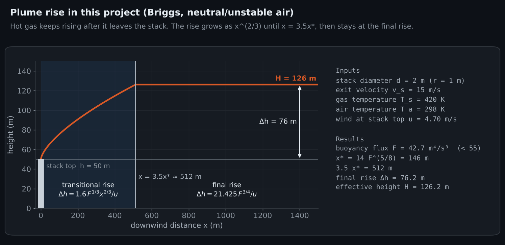

**Step 2: Dispersion coefficients** (class C, rural), shown here at $x = 1231\text{ m}$, the distance where the maximum turns out to be:

* $\sigma_y = 0.11 \times 1231 \times (1 + 0.0001 \times 1231)^{-1/2} = 127.8\text{ m}$
* $\sigma_z = 0.08 \times 1231 \times (1 + 0.0002 \times 1231)^{-1/2} = 88.2\text{ m}$

**Step 3: Ground-level concentration on the centreline**

$$
C(1231, 0, 0) = \frac{100}{\pi \times 4.70 \times 127.8 \times 88.2}\,\exp\left(-\frac{126.2^2}{2 \times 88.2^2}\right)
$$

$$
C(1231, 0, 0) = 6.01 \times 10^{-4} \times 0.359 = 2.16 \times 10^{-4}\text{ g/m}^3 = 216\ \mu\text{g/m}^3
$$

At this distance, $\sigma_z = 88.2\text{ m}$ is very close to $H/\sqrt{2} = 89.3\text{ m}$, so this is (almost exactly) the maximum ground-level concentration. The code scans the whole centreline and finds the same maximum: 216 µg/m³ at 1231 m downwind.

## Results & Code

The code ([`Gaussian_Plume_Stack_Dispersion.py`](Gaussian_Plume_Stack_Dispersion.py)) performs Steps 1–5 for any inputs and saves the figures in the `images` folder. All result figures use the same colour scale (µg/m³), so they can be compared directly.

### 3D View

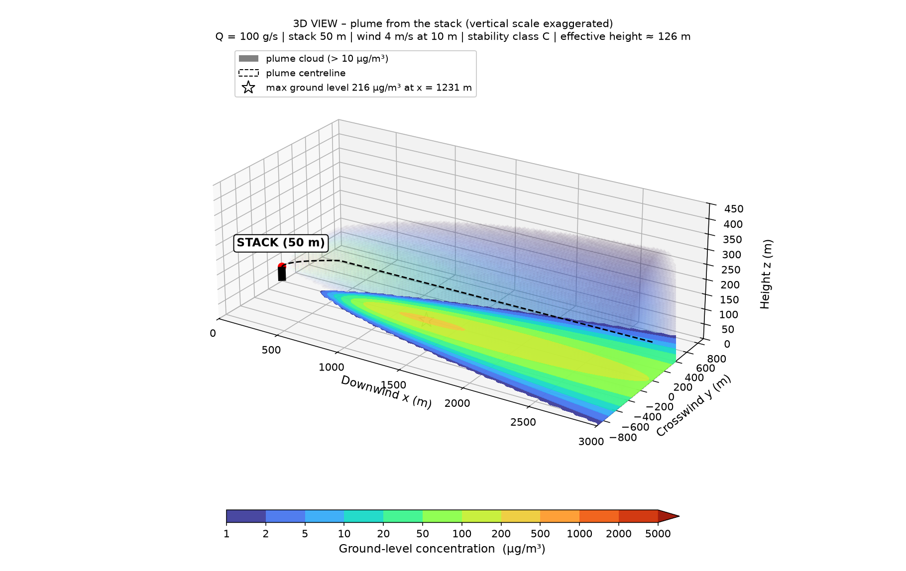

* The black column is the stack (50 m), and the dashed line is the plume centreline, which rises to 126 m.
* The three transparent surfaces enclose the air with more than 20, 100 and 1000 µg/m³.
* The coloured area on the ground is the ground-level concentration (the same map as the top view), and the star marks the maximum.
* The vertical scale is exaggerated so that the shapes can be seen.

### Top View (x–y) at Ground Level

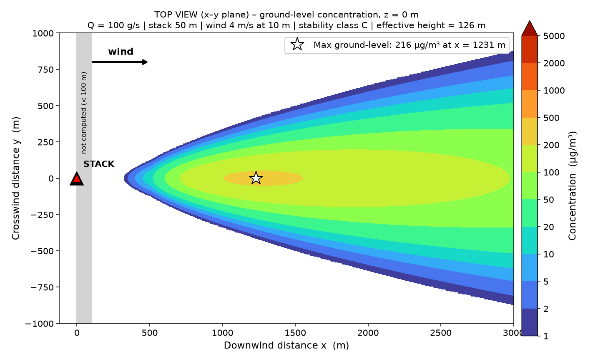

* Close to the stack, the ground-level concentration is almost zero because the plume is still high above the ground. It first exceeds 1 µg/m³ about 320 m downwind.
* The maximum, 216 µg/m³, is on the centreline 1231 m downwind.
* The plume widens downwind as $\sigma_y$ grows. The grey strip marks the first 100 m, where nothing is calculated.

### Side View (x–z) Along the Centreline

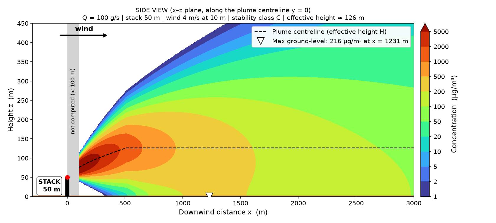

* The plume rises from 50 m to 126 m within the first 512 m (dashed line). The bend in the centreline at 512 m is where the transitional rise ends and the final rise begins.
* The highest concentrations (above 1000 µg/m³) are in the air close to the stack, not at the ground.
* Further downwind, the plume spreads vertically and reaches the ground; the ground-level maximum is at 1231 m.

### Cross-Sections (y–z), Looking Downwind

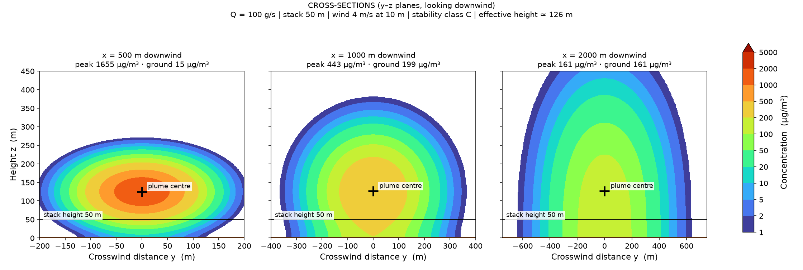

* At 500 m, the plume is a compact Gaussian ellipse centred at 125 m height: 1655 µg/m³ at its centre but only 15 µg/m³ at the ground.
* At 1000 m, it has spread and touched the ground: 443 µg/m³ at its centre and 199 µg/m³ at the ground.
* At 2000 m, the plume fills the whole layer, and ground reflection makes the ground value (161 µg/m³) as high as anywhere in the section.

### Ground-Level Concentration Along the Centreline

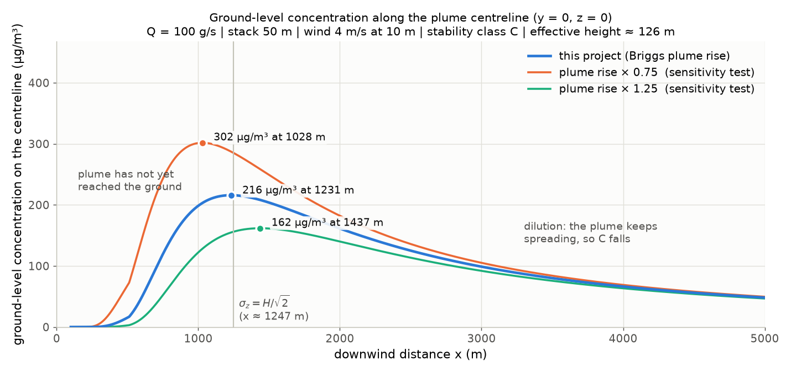

* The rising part of the curve is the plume mixing down to the ground; the falling part is dilution as the plume keeps spreading. The small bend near 500 m is where the plume rise ends.
* The plume rise is the most sensitive input, because $C_{max} \propto 1/H^2$. If the rise is 25 % lower, the maximum increases to 302 µg/m³ and moves closer to the stack (about 1030 m). If it is 25 % higher, the maximum drops to 162 µg/m³ at about 1440 m. Hanna et al. (1982) note that the 1.6 coefficient in the 2/3 law is only accurate to within about ±40 %.

### Results Summary

| Result | Value |
| :--- | :--- |
| Wind speed at the stack top | $4.70\text{ m/s}$ |
| Buoyancy flux | $42.7\text{ m}^4/\text{s}^3$ |
| Final plume rise | $76.2\text{ m}$ (reached at $512\text{ m}$) |
| Effective stack height | $126.2\text{ m}$ |
| Maximum ground-level concentration | $216\ \mu\text{g/m}^3$ |
| Location of the maximum | $1231\text{ m}$ downwind, on the centreline |
| $\sigma_z$ at the maximum | $88.2\text{ m}$ ($H/\sqrt{2} = 89.3\text{ m}$) |

## Verification: Are the Results Correct?

1. **Mass balance:** The code integrates $u\,C$ over vertical planes at 200, 500, 1000, 2000 and 5000 m. The result equals $1.0000\,Q$ at every distance, so no pollutant is created or lost.
2. **Analytical maximum:** $C_{max} = \frac{2Q}{\pi e u H^2}\frac{\sigma_z}{\sigma_y}$ gives 216.0 µg/m³, against 215.9 µg/m³ from scanning the centreline.
3. **Published worked examples** ([`Validation_Examples.py`](Validation_Examples.py)): The published solutions use the Pasquill–Gifford (P–G) dispersion coefficients (the EPA ISC3 curve fits), while this project uses the Briggs formulas. So the validation script runs the same Gaussian plume code twice: once with the P–G coefficients, to check the equation and the code against the published numbers, and once with the Briggs coefficients used in this project.

* **Example 1** (AgentCalc): $Q$ = 100 g/s, effective height $H$ = 50 m, wind $u$ = 5 m/s, receptor on the centreline 1 km downwind at 1.5 m height.
* **Example 2** (course notes): $Q$ = 110 g/s, $H$ = 100 m, $u$ = 5 m/s, class D; find the maximum ground-level concentration.

All values are in µg/m³, with the difference from the published value in brackets:

| Test case | Published | This code, P–G σ | This code, Briggs σ (this project) |
| :--- | :---: | :---: | :---: |
| Example 1, rural class D | 866 | 866 (+0.1 %) | 924 (+6.7 %) |
| Example 1, urban class D | 353 | same as Briggs \* | 353 (0.0 %) |
| Example 1, rural class F | 23 | 23.4 (+1.9 %) | 3.9 (−82.8 %) |
| Example 2, maximum (class D) | 178 (nomogram) / 183 (equation) | 179 at 3.0 km (+0.6 % / −2.1 %) | 201 at 2.2 km (+12.9 % / +9.8 %) |

\* For urban areas, both the published method and this code use the Briggs urban formulas.

**What the table shows:**

* With the same dispersion coefficients as the published solutions, the code reproduces all of them within 2 %, and in Example 2 it even finds the maximum at the same distance (3.0 km against about 3 km). So the equation and the code are correct.
* With the Briggs coefficients used in this project, the results are 7–13 % higher in neutral air. This difference comes from the two σ schemes, not from the code: at 1 km in class D, Briggs gives $\sigma_y$ = 76.3 m and $\sigma_z$ = 37.9 m, against 68.1 m and 32.1 m for P–G.
* The class F receptor is far in the tail of the plume: it is at the ground, 48.5 m below the centre of a very thin plume. There, the concentration is extremely sensitive to $\sigma_z$. At 1 km, Briggs gives $\sigma_z$ = 12.3 m and P–G 14.0 m, and this difference of about 12 % changes the result by a factor of six.

The script also draws the two methods along the whole distance, for both examples:

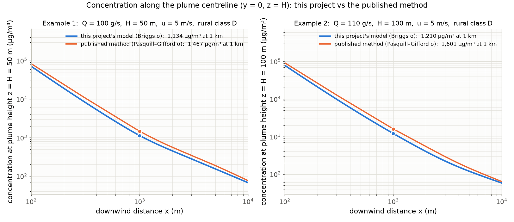

* Along the plume centreline (at the plume height), both methods give the same shape: the concentration falls by about three orders of magnitude between 100 m and 10 km as the plume spreads.
* The Briggs line is 9–27 % lower because its plume cross-section ($\sigma_y \sigma_z$) is larger: 1,134 against 1,467 µg/m³ at 1 km in Example 1.

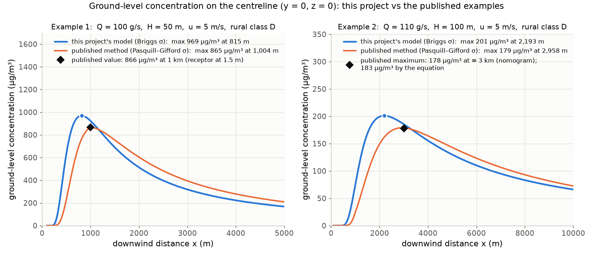

* At ground level, the P–G curve (the published method) passes through the published values: 865 µg/m³ at about 1 km in Example 1, and a maximum of 179 µg/m³ at about 3 km in Example 2.
* This project's model (Briggs) gives a higher maximum closer to the stack (969 µg/m³ at 815 m in Example 1, and 201 µg/m³ at 2,193 m in Example 2). Its $\sigma_z$ grows faster near the source, so the plume reaches the ground sooner.
* Far downwind, the Briggs line is lower, because its plume is wider.

## How to Run the Code

1. Download the repository (green **Code** button → **Download ZIP**) and **extract** it (right-click → **Extract All**). Do not run the files from inside the zip: Windows opens each file of a zip in its own temporary folder, so the validation script cannot find the main script.
2. Open the extracted folder in VS Code (**File → Open Folder**).
3. Install the libraries and run the two scripts:

```bash
pip install -r requirements.txt
python Gaussian_Plume_Stack_Dispersion.py
python Validation_Examples.py
```

* `Gaussian_Plume_Stack_Dispersion.py` prints the main results, saves five figures in the `images` folder next to the script (`plume_3d_view.png`, `top_view_xy.png`, `side_view_xz.png`, `cross_sections_yz.png` and `ground_level_profile.png`) and opens them in windows. In the 3D window, you can rotate the plume with the mouse.
* `Validation_Examples.py` prints the verification table above, saves `validation_centreline.png` and `validation_ground_level.png` in the same folder and opens them in windows.
* The figure windows may open behind VS Code (check the taskbar). Each script finishes when you close its windows.

To change the scenario, edit these two lines at the bottom of `Gaussian_Plume_Stack_Dispersion.py`:

```python
src = Source(Q=100, h_s=50, d=2.0, v_s=15.0, T_s=420.0)
met = Met(u_ref=4.0, z_ref=10.0, stability="C", T_a=298.0, L=None, terrain="rural")
```

* `Source`: emission rate (g/s), stack height (m), diameter (m), exit velocity (m/s), gas temperature (K).
* `Met`: wind speed (m/s) at height `z_ref` (m), stability class (A–F), air temperature (K), mixing height `L` (m, or `None`), and `"rural"` or `"urban"`.
* scikit-image is only used to draw the 3D surfaces; without it, the code shows the 3D plume as a point cloud.

## Limitations and Further Work

### Limitations

* **Steady state and uniform wind:** The results are about one-hour averages for constant conditions. They are not directly comparable with air quality standards for other averaging times (for example, 24 hours or one year).
* **Flat terrain without buildings:** Hills, valleys and building downwash are not included.
* **Conservative pollutant:** There is no chemical reaction (for example, NO turning into NO₂), no deposition and no washout by rain, and particles are not treated.
* **Simple turbulence description:** Six stability classes are a coarse description of the atmosphere, and the plume rise formulas carry an uncertainty of about ±40 %.
* **Range:** The formulas are valid from about 100 m to 10 km downwind, and not for calm winds (below 1 m/s).
* **Background:** Pollution from other sources is not included.

### Further Work and Advanced Models

* Use real hourly meteorological data (wind speed, direction and stability) with a wind rose to calculate long-term average concentration maps.
* A Gaussian **puff** model, which follows separate puffs of pollutant, for releases or winds that change with time.
* Regulatory models: **AERMOD** (the U.S. EPA's preferred model, which replaced ISC3) and **CALPUFF**.
* **CFD** (for example, OpenFOAM or ANSYS Fluent) for complex terrain and buildings, and Lagrangian particle models for long-range transport.

## References

### Equations and coefficients

* Briggs, G. A. (1969). *Plume Rise*. USAEC Critical Review Series, TID-25075. U.S. Atomic Energy Commission. [Record](https://firedoc.nist.gov/article/73cxXYQBWEcjUZEYsgk4)
* Briggs, G. A. (1973). *Diffusion Estimation for Small Emissions*. ATDL Contribution File No. 79. Atmospheric Turbulence and Diffusion Laboratory, NOAA, Oak Ridge, TN.
* Briggs, G. A. (1975). Plume rise predictions. In D. A. Haugen (Ed.), *Lectures on Air Pollution and Environmental Impact Analyses* (pp. 59–111). American Meteorological Society, Boston.
* Gifford, F. A. (1961). Use of routine meteorological observations for estimating atmospheric dispersion. *Nuclear Safety*, 2(4), 47–51.
* Hanna, S. R., Briggs, G. A., & Hosker, R. P. (1982). *Handbook on Atmospheric Diffusion* (DOE/TIC-11223). U.S. Department of Energy. [PDF](https://digital.library.unt.edu/ark:/67531/metadc1090801/m2/1/high_res_d/5591108.pdf)
* Pasquill, F. (1961). The estimation of the dispersion of windborne material. *The Meteorological Magazine*, 90(1063), 33–49.
* Seinfeld, J. H., & Pandis, S. N. (2016). *Atmospheric Chemistry and Physics: From Air Pollution to Climate Change* (3rd ed.). Wiley.
* Turner, D. B. (1970). *Workbook of Atmospheric Dispersion Estimates* (PHS Publication No. 999-AP-26). U.S. Department of Health, Education, and Welfare.
* U.S. EPA (1992). *Screening Procedures for Estimating the Air Quality Impact of Stationary Sources, Revised* (EPA-454/R-92-019). [PDF](https://www.epa.gov/sites/default/files/2020-09/documents/epa-454r-92-019_ocr.pdf)
* U.S. EPA (1995). *User's Guide for the Industrial Source Complex (ISC3) Dispersion Models, Volume II: Description of Model Algorithms* (EPA-454/B-95-003b). [PDF (archived)](https://webarchive.library.unt.edu/eot2008/20081110141810/http:/www.epa.gov/scram001/userg/regmod/isc3v2.pdf)

### Worked examples used for verification

* AgentCalc. *Gaussian Plume Dispersion Calculator*, worked example of a 100 g/s stack (accessed November 2026). [Link](https://www.agentcalc.com/gaussian-plume-dispersion-calculator)
* *Gaussian Plume Model: Air Pollution Dispersion*, lecture notes (author not stated), example of the maximum ground-level concentration for class D (accessed November 2026). [Link](https://studylib.net/doc/5912141/steady-state-concentration-at-a-point--x-y-z--located-dow...)

### Python libraries

* Harris, C. R., et al. (2020). Array programming with NumPy. *Nature*, 585, 357–362.
* Hunter, J. D. (2007). Matplotlib: A 2D graphics environment. *Computing in Science & Engineering*, 9(3), 90–95.
* van der Walt, S., et al. (2014). scikit-image: Image processing in Python. *PeerJ*, 2, e453.
